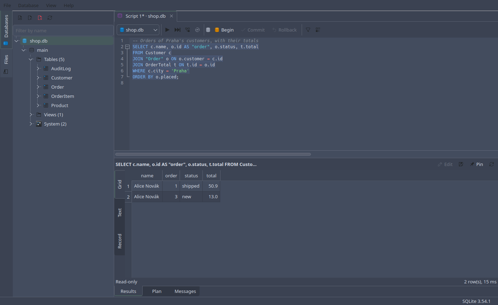

# Sqliteman

A developer's and administrator's tool for SQLite databases, built with Qt6.

Sqliteman opens SQLite files, runs SQL against them, shows and edits their
rows, and does what SQLite itself makes awkward — altering a table, for
one. It talks to SQLite through its C API, on a thread of its own, so a long
query never freezes the window.



## Version 2

Sqliteman started in 2007 as a Qt 4 program, from Igor Khanin's LiteMan,
and then stood still for years. Version 2 is a rewrite on Qt 6 and the
SQLite C API, built the way [Slonisko](https://github.com/pvanek/slonisko),
a PostgreSQL client by the same author, is built: headless libraries with
tests, a GUI on top, nothing blocking the window.

What it does:

- A database browser that follows the schema as it changes: tables, views,
  indexes, triggers, attached databases, by mouse or keyboard
- A page for every table, view and database: its rows, columns, keys,
  triggers and SQL, a database's file and settings, and an entity
  relationship diagram, exported as SVG, PNG, PDF, Mermaid or Graphviz
- An SQL editor with SQLite's highlighting, context-aware completion,
  templates, error marks where SQLite says the error is, and query plans
- Results to sort, copy, export (CSV, JSON, SQL, Excel XML, HTML and more)
  and edit in place, with a viewer for long text, JSON, images and blobs
- Alter Table for every change, done by `ALTER TABLE` or SQLite's
  documented table rebuild, in one savepoint
- Create table, index, view and trigger dialogs, a query builder, a
  populator for test data, CSV import, dumps, pragmas, and maintenance
  (`ANALYZE`, `VACUUM INTO`, integrity and foreign key checks)

## LLM/AI Note

The original Sqliteman was written by hand. Version 2 was rewritten with
the help of an LLM, following [Slonisko's](https://github.com/pvanek/slonisko) architecture. `CLAUDE.md` holds
the instructions for further patches.

## Requirements

- CMake 3.25+
- A C++20 compiler
- Qt 6.5+ (Core, Gui, Widgets, Concurrent; Test for the tests; optionally Help)
- [QScintilla](https://riverbankcomputing.com/software/qscintilla) 2.13+ for Qt 6
- SQLite 3.38+ with column metadata
- Sphinx with the MyST parser, for the manual, which is on by default:
  configure with `-DSQLITEMAN_WITH_DOCS=OFF` to build without it

When no suitable system QScintilla or SQLite is found (or with
`-DSQLITEMAN_BUNDLED_QSCINTILLA=ON` / `-DSQLITEMAN_BUNDLED_SQLITE=ON`),
CMake downloads and builds a pinned, checksummed copy.

On openSUSE Tumbleweed:

```sh
sudo zypper install cmake gcc-c++ qt6-base-devel qt6-help-devel qscintilla-qt6-devel sqlite3-devel
```

## Building

```sh
cmake -S . -B build -G Ninja
cmake --build build
ctest --test-dir build --output-on-failure
./build/src/app/sqliteman
```

The tests need neither a server nor a display: they make their databases
in temporary directories, and the widget tests run on Qt's offscreen
platform.

## Layout

| Directory       | Target                | Purpose                                                  |
|-----------------|-----------------------|----------------------------------------------------------|
| `src/sqlite`    | `Sqliteman::Sqlite`   | The SQLite C API: async connection, queries, cancel, row store, quoting |
| `src/config`    | `Sqliteman::Config`   | Preferences, recent files                                |
| `src/sql`       | `Sqliteman::Sql`      | SQLite lexer, keywords, statement splitting              |
| `src/catalog`   | `Sqliteman::Catalog`  | Schema snapshot, alter table, row editing, export, import, populator, query builder, dumps, pragmas, completion, query plans |
| `src/app`       | `sqliteman`           | The GUI                                                  |

Each library keeps its Qt Test unit tests in its own `tests/` subdirectory.
Only `src/app` may depend on Qt Widgets. `logo_design/` holds the original
logo artwork; `tools/screenshots` takes the manual's pictures.

## Documentation

The manual lives in [`docs/`](docs/index.md): using the program, and how it
is put together, and it is online at <https://pvanek.github.io/sqliteman/>.
From the same sources it builds into that website and into a Qt help file,
which the program shows itself — Help → Manual, or F1 on the page you are
looking at.

```sh
cmake --build build --target docs           # build/docs/html and sqliteman.qch
```

See [building](docs/development/building.md) for the details,
[architecture](docs/development/architecture.md) for how it is put together.

## Credits

Petr Vanek, with Igor Khanin's LiteMan to start from, Kamil Les's testing,
the translators of version 1, and everyone who sent a patch. The logo and
the icon are by Anouk Voogt.

## License

Sqliteman is free software, licensed under the GNU General Public License,
version 3 or (at your option) any later version. See [LICENSE](LICENSE).
